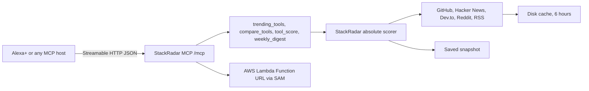

# StackRadar MCP

StackRadar MCP is a voice-ready [Model Context Protocol](https://modelcontextprotocol.io) server for the Amazon Developer Hackathon Alexa+ track. It scores about 30 developer tools from 0 to 100 with the same absolute momentum formula as [StackRadar](https://github.com/amantebriwal4321/StackRadar), then returns a short line a speaker can say.

The server speaks MCP spec **2025-11-25** and **2026-07-28** over **Streamable HTTP**, using the official Python SDK (`mcp` 2.3). A saved snapshot answers when GitHub, Hacker News, Dev.to, Reddit, or RSS does not.

## Tools

| Tool | What you ask | What you get |
| --- | --- | --- |
| `trending_tools` | category and window | ranked tools, plus a spoken top three |
| `compare_tools` | two names | both scores, the gap, and which part of the formula caused it |
| `tool_score` | one name | 0 to 100, stage, and the points from stars, forks, and mentions |
| `weekly_digest` | optional category | score leaders, and who got louder in conversation this week |

Categories: `all`, `web`, `ai`, `data`, `cloud`, `devops`, `systems`, `security`, `web3`.

Windows: `24h`, `7d`, `30d`.

## Score

Ported from `calculate_all_tool_scores` in StackRadar's [`scoring.py`](https://github.com/amantebriwal4321/StackRadar/blob/main/backend/app/services/scoring.py):

* GitHub stars, 60 percent, log scale from 500 to 300,000
* GitHub forks, 15 percent, log scale from 50 to 60,000
* Community mentions, 25 percent, capped at 25 mentions

Mentions are Hacker News + Dev.to + Reddit + news. One tool's score does not move because another tool moved. Mention text is matched on word boundaries with the same keywords as the StackRadar catalog, so "going" does not count as Go.

The weekly "louder" line is separate. It is the change in mention counts against the saved baseline. A week of stars barely moves a log scale, so the digest says both things: who leads the score, and whose conversation grew.

## Architecture



Each tool result has two parts. The text content is the spoken line. `structuredContent` holds the breakdown, the data source (`live`, `seed`, or `mixed`), and the snapshot date.

`stackradar_mcp/server.py` builds an `MCPServer` and serves it with `run(transport="streamable-http", json_response=True, stateless_http=True)`. The demo client in `clients/demo_client.py` connects with `mcp.Client` over that URL. Both are real protocol calls, not a README mention.

## Run it locally

Python 3.10 or newer. This repo is tested on 3.12.

```bash
python3 -m venv .venv
source .venv/bin/activate
pip install -e ".[dev]"
pytest
```

Snapshot mode never calls the network. Use it for a demo that cannot stall:

```bash
STACKRADAR_MODE=seed STACKRADAR_PORT=8741 stackradar-mcp
```

In another terminal:

```bash
python clients/demo_client.py
```

You should see a protocol version of `2025-11-25` or later, then a spoken line for each tool.

Live mode tries the public APIs and fills gaps from the snapshot. Optional `GITHUB_TOKEN` raises the GitHub rate limit. Results cache under `.cache/stackradar` for six hours. A failed source is remembered for 15 minutes.

```bash
STACKRADAR_MODE=auto STACKRADAR_PORT=8741 stackradar-mcp
```

Health check: [http://127.0.0.1:8741/health](http://127.0.0.1:8741/health)

A short landing page is at [http://127.0.0.1:8741/](http://127.0.0.1:8741/).

### Environment

| Variable | Default | Role |
| --- | --- | --- |
| `STACKRADAR_MODE` | `auto` | `auto` or `live` fetches public APIs. `seed` uses only the snapshot. |
| `STACKRADAR_HOST` | `127.0.0.1` | Bind address. Docker and Lambda use `0.0.0.0`. |
| `STACKRADAR_PORT` | `8741` | Listen port. |
| `STACKRADAR_CACHE_DIR` | `.cache/stackradar` | JSON cache. Lambda uses `/tmp/stackradar-cache`. |
| `STACKRADAR_CACHE_TTL_SECONDS` | `21600` | How long a successful fetch is reused. |
| `STACKRADAR_LIVE_BUDGET_SECONDS` | `8` | Cap on a live refresh so a voice reply still returns. |
| `GITHUB_TOKEN` | empty | Optional token for `api.github.com`. |
| `STACKRADAR_MCP_URL` | `http://127.0.0.1:8741/mcp` | Where the demo client connects. |

## Point a host at it

`clients/mcp.json` is a sample config for hosts that take a remote MCP URL, including Cursor:

```json
{
  "mcpServers": {
    "stackradar": {
      "type": "http",
      "url": "http://127.0.0.1:8741/mcp"
    }
  }
}
```

The server instructions tell the model to speak the tool text and to skip the JSON unless someone asks for the breakdown. The `alexa_briefing` prompt repeats that for a single question.

## Alexa+

Amazon's Alexa+ add-on toolkit (the Alexa AI CLI, the MCP Toolkit, and the web simulator) is in preview for select partners. The hackathon FAQ says participants cannot apply for access, and a self hosted MCP server plus your own client is the path that counts. This repo is that server. The demo client is the stand-in.

When a self serve console exists, register this endpoint:

* Transport: Streamable HTTP
* URL: `https://<your-host>/mcp`
* Responses: one JSON body per POST (`json_response`), no session (`stateless_http`)
* Spec: 2025-11-25 or later. This server also accepts 2026-07-28.

Phrases that map cleanly onto the tools:

* "What's trending in AI this week?"
* "Compare FastAPI and Next.js."
* "What's the score for Ollama?"
* "Give me the weekly developer digest."

The spoken lines avoid markdown and emoji on purpose. A smart speaker will read them as written.

## Docker

```bash
docker build -t stackradar-mcp .
docker run --rm -p 8741:8741 -e STACKRADAR_MODE=seed stackradar-mcp
```

The image listens on `0.0.0.0:8741`. The same image can be pushed to Amazon ECR and run on App Runner. The SAM template below is the path that does not need a registry.

## AWS Lambda

`template.yaml` is an AWS SAM app. It packages this repo as a Python 3.12 function and puts a Function URL in front of it. `stackradar_mcp/lambda_handler.py` wraps the same Starlette app with Mangum.

Buffered function URLs cannot carry an SSE stream. The app therefore answers with a single JSON body and does not keep an MCP session, so any warm container can serve the next call. The function URL is public (`AuthType: NONE`) so a judge can call it. Switch that to `AWS_IAM` if you leave it up.

```bash
sam build
sam deploy --guided
```

Copy `samconfig.toml.example` to `samconfig.toml` if you want a starting point. The MCP URL is the function URL plus `mcp`. Health is the function URL plus `health`.

This environment does not have an AWS account, so the template is not deployed from here. Deploy needs your credentials.

## Tests

```bash
pytest
```

The suite locks the StackRadar formula (including the absolute-score property and the 25 mention cap), checks spoken lines, proves seed mode makes no HTTP calls, proves a live merge when Reddit returns 403, and calls all four tools both in process and over Streamable HTTP.

## Layout

```
stackradar_mcp/server.py          MCP entry point and HTTP routes
stackradar_mcp/scoring.py         Ported StackRadar formula
stackradar_mcp/signals.py         Live fetches, cache, snapshot fallback
stackradar_mcp/data/seed_signals.json
clients/demo_client.py            Streamable HTTP demo
clients/mcp.json                  Sample host config
template.yaml                     SAM: Lambda Function URL
Dockerfile
DEVPOST.md                        Draft submission and video script
FRICTION_LOG.md                   What got in the way
```

Refresh star and fork counts in the snapshot when you want newer GitHub totals. Mention baselines stay as they are, so the weekly comparison still has a prior week:

```bash
python scripts/build_seed.py --live-stars
```

## License

MIT. See [LICENSE](LICENSE).
