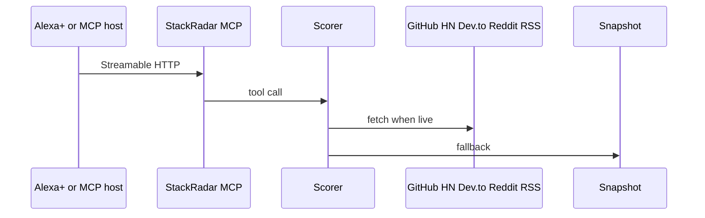

# StackRadar MCP

A small MCP server so you can ask which developer tools are heating up. It uses the same 0 to 100 momentum math as [StackRadar](https://github.com/amantebriwal4321/StackRadar): GitHub stars 60 percent, forks 15 percent, community mentions 25 percent. Each answer includes a short line you can say out loud.

The server is the official Python MCP SDK on Streamable HTTP. It speaks spec 2025-11-25 and 2026-07-28. If a public API is down, a saved snapshot still answers.

## Tools

- `trending_tools`: category and window. Ranked list, plus a spoken top three.
- `compare_tools`: two names. Scores, the gap, and which part of the formula caused it.
- `tool_score`: one name. Score, stage, and the points from stars, forks, and mentions.
- `weekly_digest`: optional category. Score leaders, and who got louder this week.

Categories: `all`, `web`, `ai`, `data`, `cloud`, `devops`, `systems`, `security`, `web3`.

Windows: `24h`, `7d`, `30d`.

## How a request moves



The text you hear is the spoken line. The structured result holds the breakdown and whether the numbers came from live data, the snapshot, or a mix.

## Alexa+

This is a self hosted MCP server for the Alexa+ track. The entry point is `stackradar-mcp`, which is `python -m stackradar_mcp`. It imports the official SDK and serves Streamable HTTP at `/mcp`. Sample host config: `clients/mcp.json`.

Amazon's Alexa+ add-on tools (CLI, MCP Toolkit, web simulator) are partner preview only. The hackathon FAQ says you cannot get access, and you do not need them. Demo with the included client, or any MCP host pointed at `http://127.0.0.1:8741/mcp`.

When Amazon opens registration, use that URL path `/mcp`. Responses are one JSON body per call, with no session, so a plain HTTPS endpoint is enough.

Things you can say:

- What's trending in AI this week?
- Compare FastAPI and Next.js.
- What's the score for Ollama?
- Give me the weekly developer digest.

Spoken lines are plain sentences. No markdown. No emoji.

## Run it

Python 3.10 or newer. Tested on 3.12.

```bash
python3 -m venv .venv
source .venv/bin/activate
pip install -e ".[dev]"
pytest
STACKRADAR_MODE=seed STACKRADAR_PORT=8741 stackradar-mcp
```

Other terminal:

```bash
python clients/demo_client.py
```

You should see protocol `2025-11-25` or later, then a spoken line for each tool.

`STACKRADAR_MODE=auto` tries live APIs and fills gaps from the snapshot. Optional `GITHUB_TOKEN` raises the GitHub rate limit. Cache lives in `.cache/stackradar` for six hours.

Health: [http://127.0.0.1:8741/health](http://127.0.0.1:8741/health)

Landing page: [http://127.0.0.1:8741/](http://127.0.0.1:8741/)

Settings:

- `STACKRADAR_MODE`: `auto` fetches live data. `seed` uses only the snapshot. Default is `auto`.
- `STACKRADAR_HOST`: bind address. Default `127.0.0.1`. Docker uses `0.0.0.0`.
- `STACKRADAR_PORT`: default `8741`.
- `STACKRADAR_CACHE_DIR`: default `.cache/stackradar`. Lambda uses `/tmp/stackradar-cache`.
- `STACKRADAR_CACHE_TTL_SECONDS`: default 6 hours.
- `STACKRADAR_LIVE_BUDGET_SECONDS`: default 8. A slow API does not stall the reply.
- `GITHUB_TOKEN`: optional.
- `STACKRADAR_MCP_URL`: demo client target. Default `http://127.0.0.1:8741/mcp`.

## Docker

```bash
docker build -t stackradar-mcp .
docker run -p 8741:8741 -e STACKRADAR_MODE=seed stackradar-mcp
```

The image listens on port 8741. The same image can run on App Runner. The SAM template is the path that does not need a registry.

## AWS Lambda

`template.yaml` packages this repo as a Python 3.12 function and puts a Function URL in front of it. `stackradar_mcp/lambda_handler.py` wraps the same app with Mangum.

Each POST returns one JSON body, and the server keeps no session, so a buffered Function URL can host it. The URL is public so a judge can call it. Switch the auth type to AWS_IAM if you leave it up.

```bash
sam build
sam deploy
```

`sam deploy` will ask you the usual questions the first time. Copy `samconfig.toml.example` to `samconfig.toml` if you want a starting point. The MCP path is the function URL plus `mcp`. Health is the function URL plus `health`.

Deploy needs your AWS account. It is not deployed from here.

## Tests

```bash
pytest
```

The tests lock the StackRadar formula, check the spoken lines, prove snapshot mode makes no HTTP calls, prove a live merge when Reddit is blocked, and call all four tools in process and over Streamable HTTP.

## Layout

- `stackradar_mcp/server.py`: MCP entry point and HTTP routes
- `stackradar_mcp/scoring.py`: the StackRadar formula
- `stackradar_mcp/signals.py`: live fetches, cache, snapshot fallback
- `stackradar_mcp/data/seed_signals.json`: the snapshot
- `clients/demo_client.py`: Streamable HTTP demo
- `clients/mcp.json`: sample host config
- `template.yaml`: Lambda Function URL
- `Dockerfile`: container image
- `DEVPOST.md`: draft submission and video script
- `FRICTION_LOG.md`: what got in the way

Refresh star and fork counts with:

```bash
python scripts/build_seed.py live
```

Mention baselines stay put, so the weekly line still has a prior week.

## License

MIT. See [LICENSE](LICENSE). GitHub shows it in the About section when this file sits at the repo root.
